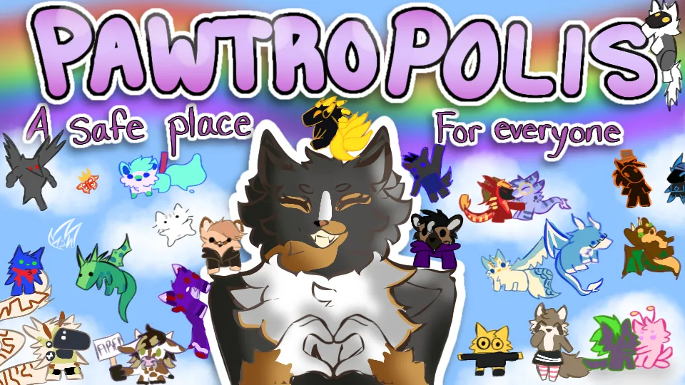

<p align="center">
  
</p>

<h1 align="center">Pawtropolis Tech</h1>

<p align="center">
  
</p>

<p align="center">
  <strong>Discord bot for community gating and moderation</strong>
</p>

<p align="center">
  <!-- CI Status -->
  <a href="https://github.com/watchthelight/pawtropolis-tech/actions/workflows/ci.yml">
    
  </a>
  <!-- Live Scheduler Health (Healthchecks.io) -->
  <a href="https://status.pawtropolis.tech">
    
  </a>
  <!-- Dynamic Badges from Gist -->
  
  
  
  
</p>

<p align="center">
  <!-- Static Badges -->
  
  
  
  
  
</p>

---

> **Staff? Read these first:**
> - **[BOT-HANDBOOK](docs/BOT-HANDBOOK.md)** -- Every command, explained
> - **[MOD-QUICKREF](docs/MOD-QUICKREF.md)** -- Cheat sheet for daily mod work
> - **[PERMS-MATRIX](docs/PERMS-MATRIX.md)** -- Who can run what

---

## Overview

Pawtropolis Tech is a server-owned verification system that handles community onboarding through structured application flows. It replaces manual DM-based screening with a permission-gated workflow so staff stay accountable and applicants stay informed.

Every review action is logged, every decision is attributable, and the bot stays out of the way when it has no work to do.

The current release is **26.1.0** (2026-11-15): [release notes](docs/releases/26.1.0.md), [changelog](CHANGELOG.md).

---

## Quick Start

Needs Node 20.9.0 or newer. CI and production run Node 24.

```bash
# Clone and install (the dashboard in web/ is its own package)
git clone https://github.com/watchthelight/pawtropolis-tech.git
cd pawtropolis-tech
npm install
(cd web && npm install && npx svelte-kit sync)

# Configure environment
cp .env.example .env
# Edit .env with your DISCORD_TOKEN and CLIENT_ID

# Run the checks CI enforces
npm run typecheck && npm run lint && npm run knip && npm test && npm run build

# Start development server
npm run dev
```

**Key Scripts:**
| Command | Description |
|---------|-------------|
| `npm run dev` | Development mode with hot reload |
| `npm run build` | Build for production |
| `npm run test` | Run test suite |
| `npm run typecheck` | Type-check `src/` and `scripts/` |
| `npm run lint` | ESLint; errors fail CI, warnings do not |
| `npm run knip` | Find unused files, exports and dependencies |
| `npm run check` | Typecheck, lint, format check and tests in one go. It stops at the format check until the older files are formatted (see [ci-policy](docs/operations/ci-policy.md)) |
| `npm run deploy:cmds` | Deploy slash commands to Discord |

The dashboard has its own scripts, run inside `web/`: `npm run dev`, `npm run check` and `npm run build`. `npm run knip` and the full test suite both look into `web/`, which is why the dashboard is installed and synced first.

---

## Features

### Application Gating
- Interactive modal forms with multi-page question flows
- Configurable per-guild questions via SQLite schema
- Draft recovery for incomplete applications
- Submission validation with required field enforcement

### Review & Decision Making
- Reviewer dashboards with rich embeds and action buttons
- Claim system to prevent review collisions
- Full audit trail of approve/reject/kick decisions
- Permanent rejection feature to block repeat applications

### Modmail System
- Private thread bridge for staff-applicant DM routing
- Automatic transcript logging
- Bidirectional message forwarding with reply threading

### Avatar Risk Analysis
- Google Cloud Vision SafeSearch integration
- Configurable detection thresholds
- One-click Google Lens reverse image search

### Artist Verification Review
- `/investigate-artist`, run inside a 2D artist verification ticket by a bot owner (`OWNER_IDS`), reads the whole ticket and every image in it
- Reverse image lookups (Fluffle, and SauceNAO, e621 and Google's web detection when a key is set) and the applicant's history in the server
- A Claude API assessment against the handbook's own criteria: an advisory score, a breakdown per criterion with the evidence, flags and follow-up questions
- The reply is ephemeral and nothing is posted in the ticket. It gives indicators, never a verdict, and it never approves, denies, changes roles or messages the applicant
- Cost per run and a monthly total are tracked, and the command refuses to run past `INVESTIGATE_MONTHLY_CAP_USD`

### Service Keys From Discord
- `/service-keys` lets a bot owner set, test and remove the Google Vision, SauceNAO and e621 keys without logging in to the host
- A key goes into a private form, is tried against its service, and is stored only when the service accepts it
- It is written to the host's `.env` and used at once, with no restart. No reply and no log line ever contains a key

### Operations
- Health monitoring with uptime checks, an off-process database integrity check every 6 hours, and event-loop lag tracking on the dashboard system page
- Retention scheduler: hourly action-log search index catch-up, daily `PRAGMA optimize`, and flag-gated pruning of expired rows, deploy backups and 30-day-old verification posts (`RETENTION_ENABLED=true`)
- Sentry integration for error tracking (profiling is opt-in)
- Pino-based structured JSON logging (asynchronous, flushed on shutdown)
- Documentation parity tests: the handbook, command reference, permission matrix, env examples and dashboard config editor are checked against the code by `npm test`

---

## Configuration

### Required Environment Variables

| Variable | Description |
|----------|-------------|
| `DISCORD_TOKEN` | Bot token from Discord Developer Portal |
| `CLIENT_ID` | Application ID from Discord Developer Portal |

### Optional Environment Variables

| Variable | Description |
|----------|-------------|
| `GUILD_ID` | Guild ID for per-guild command registration |
| `SENTRY_DSN` | Sentry error tracking DSN |
| `LOG_LEVEL` | Pino log level (trace/debug/info/warn/error); production runs `info` |
| `RESET_PASSWORD` | Password for admin reset commands |
| `DB_HEALTHCHECK_MODE` | Boot-time integrity check: `quick` (production default), `full` or `skip` |
| `RETENTION_ENABLED` | Lets the retention scheduler delete instead of logging a dry run |
| `SENTRY_PROFILES_SAMPLE_RATE` | Opt-in CPU profiling (0 disables and skips loading the profiler) |
| `OWNER_IDS` | Comma-separated Discord user IDs with owner permissions. `/investigate-artist` runs for these IDs only |
| `ANTHROPIC_API_KEY`, `ANTHROPIC_WORKSPACE_ID` | Claude API key and workspace for `/investigate-artist`. Without the key the command still gathers the ticket and runs the lookups, and says the assessment was skipped |
| `INVESTIGATE_MONTHLY_CAP_USD` | Monthly spend cap for `/investigate-artist` (default 200; 0 switches the command off) |
| `SAUCENAO_API_KEY`, `E621_LOGIN`, `E621_API_KEY` | Optional lookup services. One without a key is skipped and named as skipped in the report. A bot owner can set these from Discord with `/service-keys` |
| `GOOGLE_VISION_API_KEY` | Google Cloud Vision key for the avatar scan and `/audit nsfw`. Also set from Discord with `/service-keys` |
| `DASHBOARD_API_HOST` | Bind address of the bot's internal dashboard API (default `127.0.0.1`) |

Every variable the code reads, with its default, is in [`.env.example`](.env.example) (bot) and [`web/.env.example`](web/.env.example) (dashboard); `tests/docs/env-example.test.ts` fails when either file and the code disagree.

---

## Initial Setup

```bash
# 1. Configure the gate system
/gate setup review_channel:#staff-review gate_channel:#gate general_channel:#general accepted_role:@Verified

# 2. Customize questions (optional)
/gate set-questions q1:"What is your age?" q2:"How did you find us?"

# 3. Preview welcome message
/gate welcome preview
```

### Common Commands

| Command | Description |
|---------|-------------|
| `/gate setup` | Initialize guild configuration |
| `/gate status` | View application statistics |
| `/accept @user` | Approve application |
| `/reject @user reason:"..."` | Reject with reason |
| `/modstats` | View moderator statistics |

For full command reference, see [docs/BOT-HANDBOOK.md](docs/BOT-HANDBOOK.md).

---

## Documentation

| Document | Description |
|----------|-------------|
| [BOT-HANDBOOK.md](docs/BOT-HANDBOOK.md) | Complete command reference |
| [MOD-QUICKREF.md](docs/MOD-QUICKREF.md) | Quick reference for moderators |
| [PERMS-MATRIX.md](docs/PERMS-MATRIX.md) | Permission requirements |
| [CHANGELOG.md](CHANGELOG.md) | Version history |
| [Release notes 26.1.0](docs/releases/26.1.0.md) | What changed in 26.1.0, the move of the host to Node 24, how to roll back |
| [Release notes 26.0.0](docs/releases/26.0.0.md) | What changed in v26, how the deploy went, how to roll back |
| [MODERNIZATION_PLAN.md](MODERNIZATION_PLAN.md) | The v26 audit: findings, what shipped, what was deferred, open decisions |
| [ci-policy.md](docs/operations/ci-policy.md) | What CI enforces and what it tolerates |
| [deployment-hardening.md](docs/operations/deployment-hardening.md) | Deploy procedure |
| [github-discord-badges](docs/reference/github-discord-badges.md) | GitHub-renderable Discord role/channel badges |

### Discord Badges in Docs

GitHub Markdown cannot render Discord mention syntax. Pawtropolis Tech
generates SVG pill badges that look like Discord mentions, use real role
names and colors, and are refreshed daily. Docs reference them as
`` instead of raw
`<@&id>` strings. See [docs/reference/github-discord-badges.md](docs/reference/github-discord-badges.md)
for the full system.

---

## License

Licensed under the **Attribution-No Wholesale Copying License (ANW-1.0)**.

You can use and modify the code for your own projects with proper attribution. You cannot redistribute the entire project as-is or rebrand it as your own work.

See [LICENSE](LICENSE) for full terms.

---

<p align="center">
  <a href="https://github.com/watchthelight">watchthelight</a> &bull;
  <a href="mailto:admin@watchthelight.org">admin@watchthelight.org</a>
</p>
